# Collection | Fans' Benefits | The Most Comprehensive Power System Codes | Updated Permanently

1. The most comprehensive directory of power system codes available online
2024-01-30  
2024-01-31  
2024-02-01  
2024-02-02  
2024-02-07  
2024-02-08  
2024-02-09  
2024-02-06  
2024-02-10  
Free sharing: Super awesome tips for electrical engineering
2024-02-04  
2024-02-04  
2024-02-04  
Matlab code running basic article explanation  
2024-02-04  
MATLAB|yalmip and cplex installation steps  
2024-02-04  
Matlab in Gurobi installation and debugging  
2024-02-06  
MATLAB|[Basic Explanation]Power System Flow Calculation Based on matpower  
2024-02-06  
MATLAB|Undefined function or variable[One article to explain thoroughly]  
2024-02-05  
2024-02-05  
2024-02-05  
2024-02-05  
Power system|IEEE paper submission process  
2024-02-05  
2024-02-05  
Journal paper exporting clear images with Visio method  
2024-02-05  
[Journal Paper]Method to keep the resolution of inserted WPS image unchanged when inserting into a document  
2024-02-06  
WPS configuration of MathType and mathtype to achieve one-click change of formula size in papers

## Images

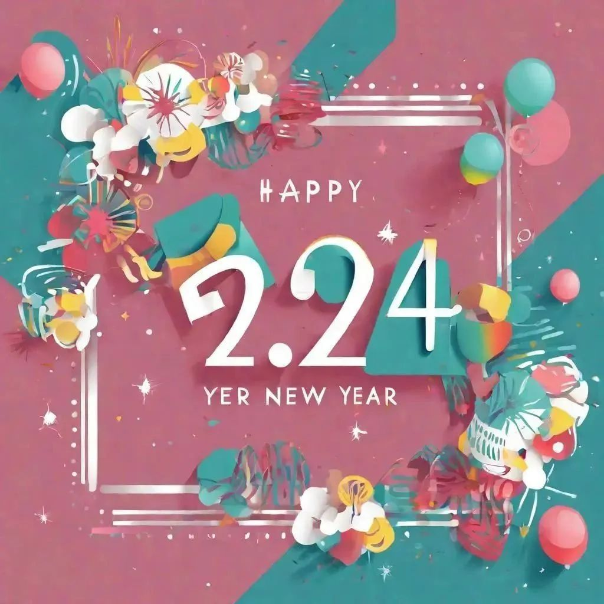

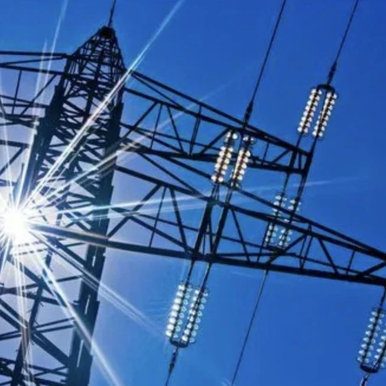
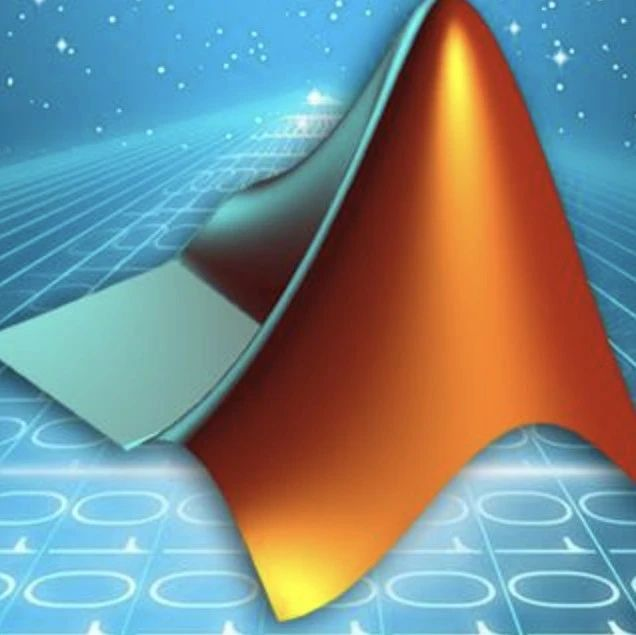
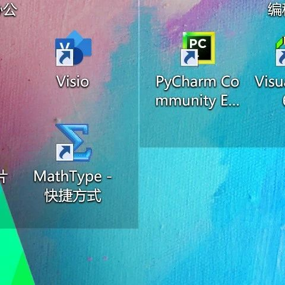
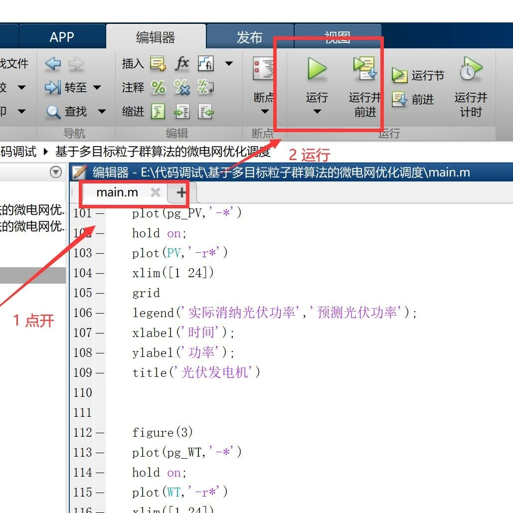
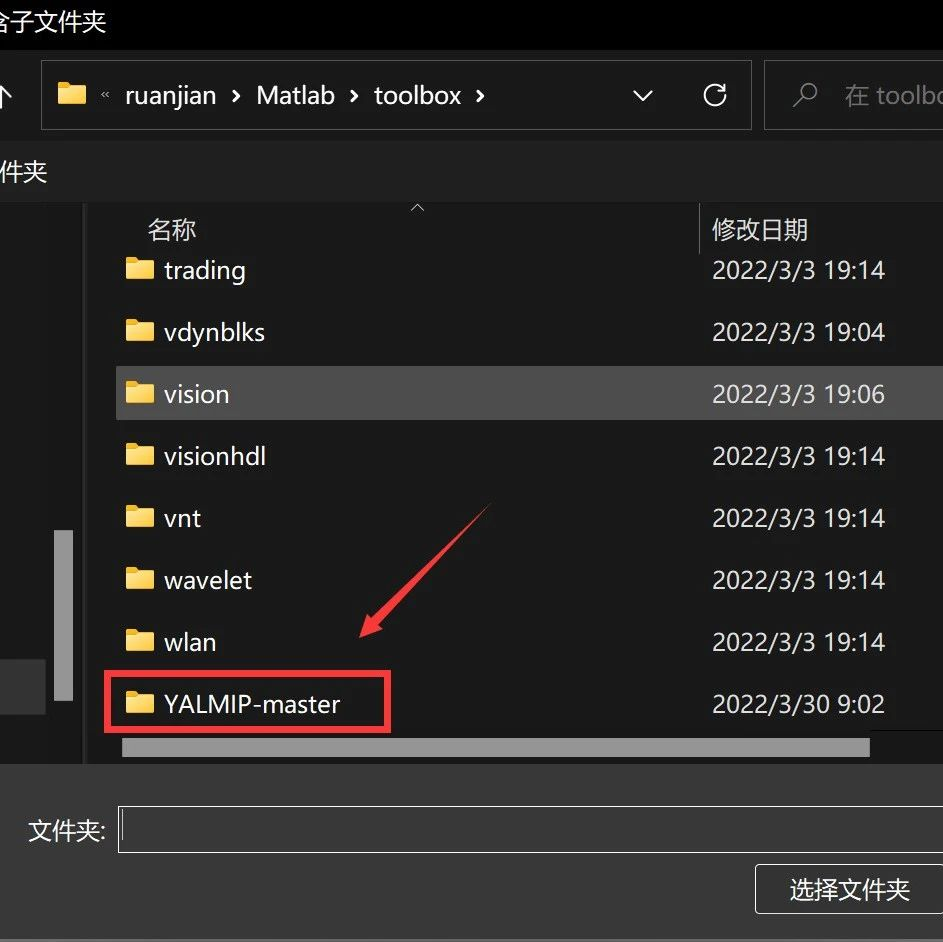
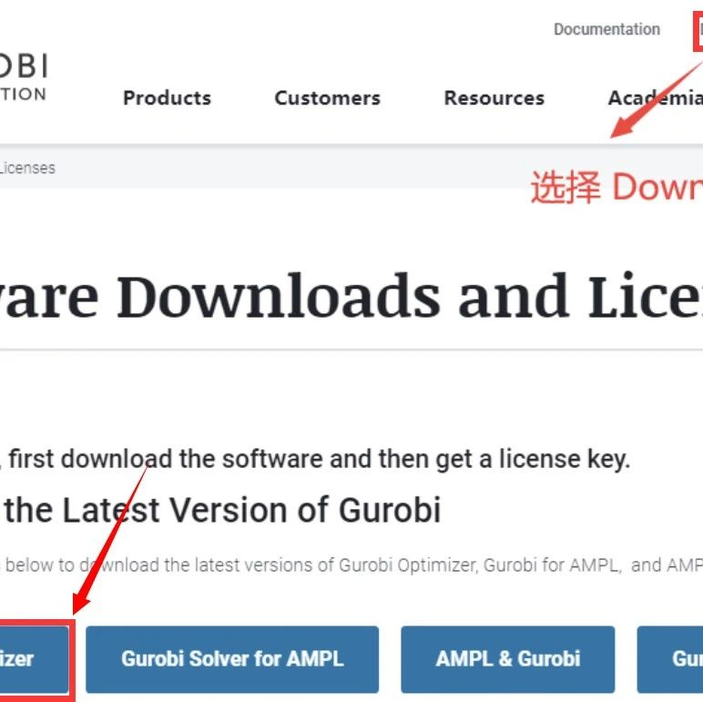
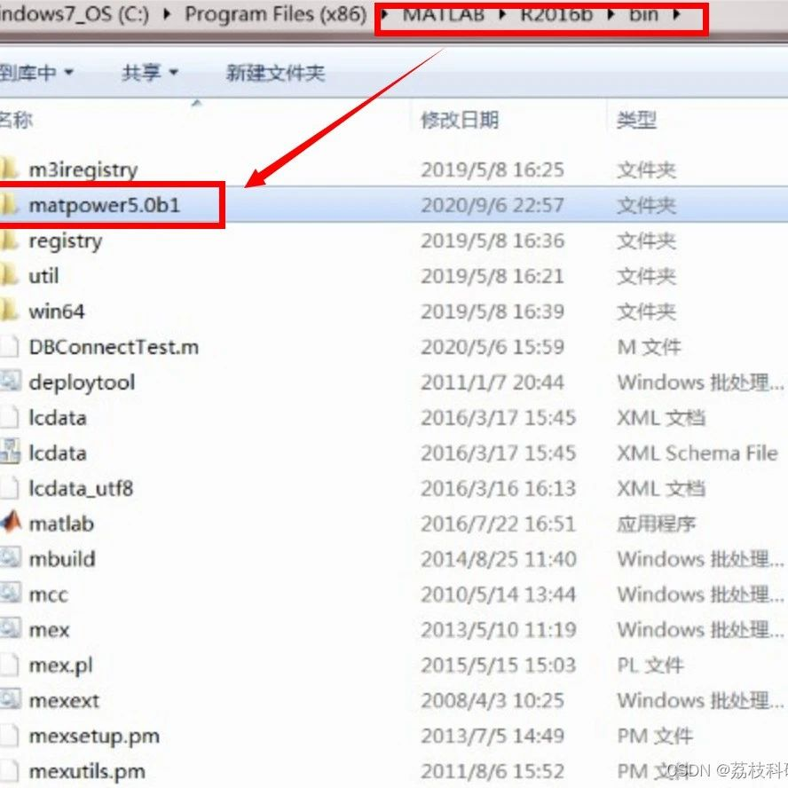
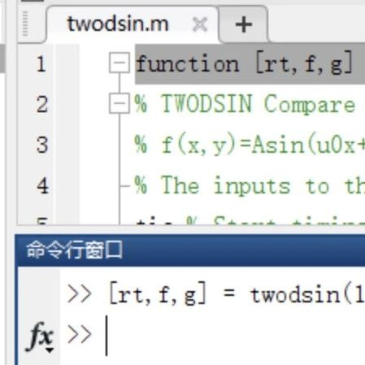
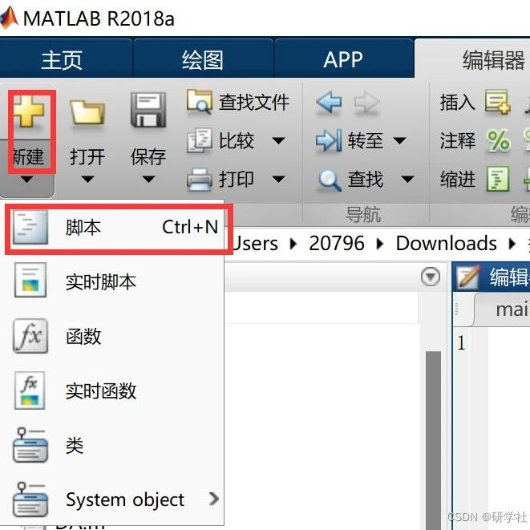

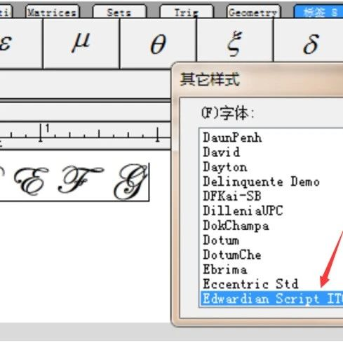

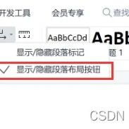
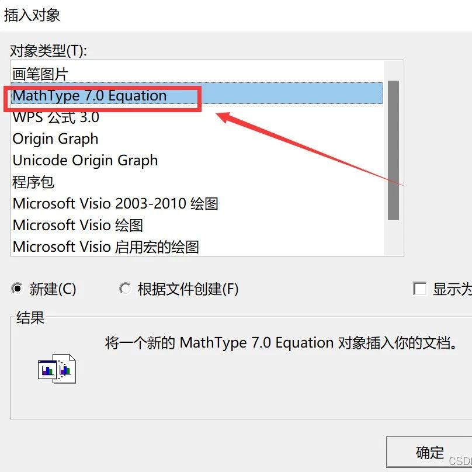
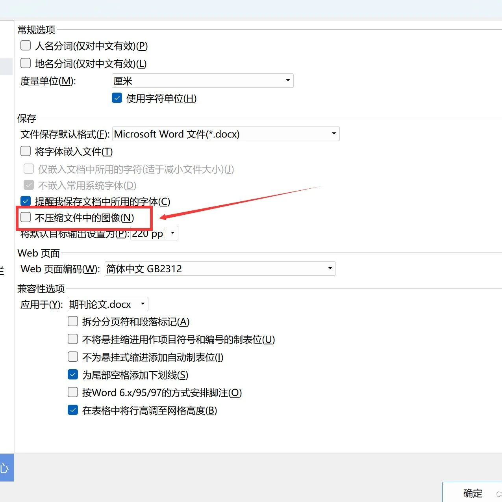

<!-- PAYMENT_BLOCK -->

## Get this dataset

- Payment link (Stripe): [Buy now](https://buy.stripe.com/3cs8yP7sY87d0vu9AB)
- Payment QR code: 

<!-- /PAYMENT_BLOCK -->
